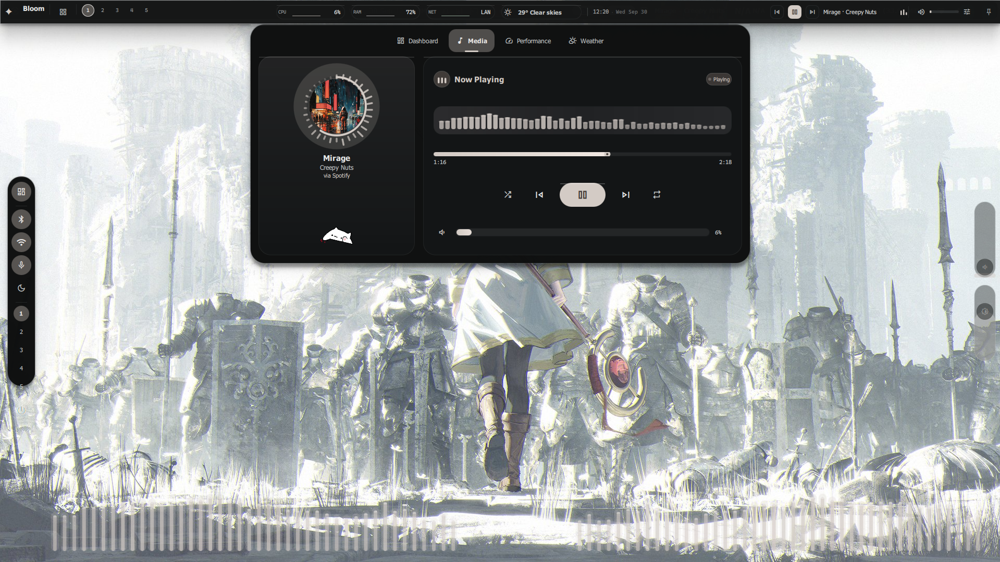
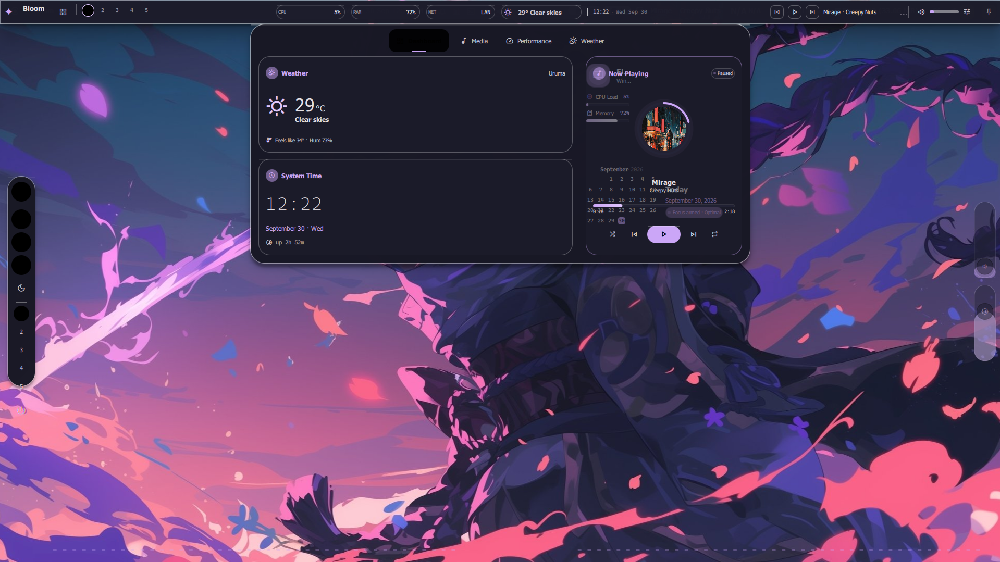
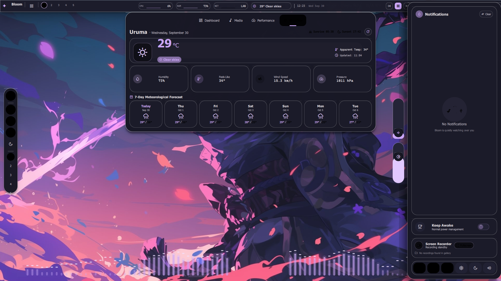
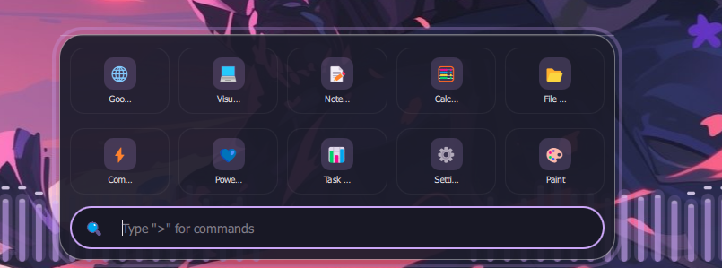
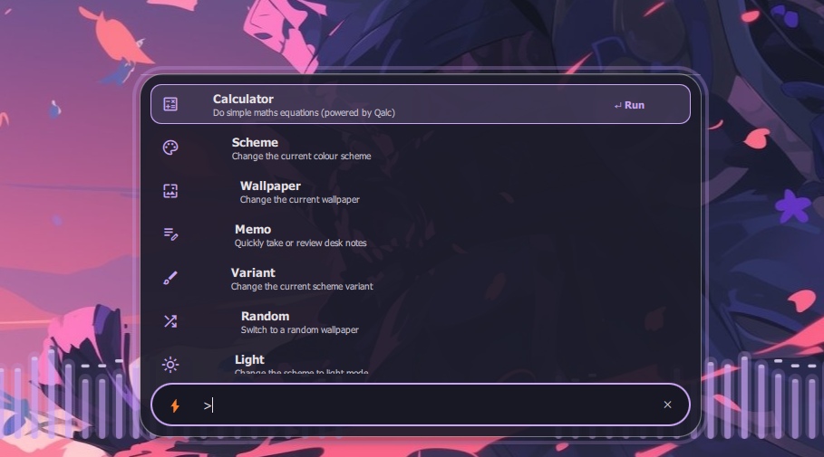

<a name="top"></a>

# Bloom 🌸

<p align="center">
  <strong>日本語</strong> | <a href="./README.md">English</a>
</p>

> **Status:** Operational / Active Development（稼働中・開発進行中）  
> **Architecture:** Bloom_Core ネイティブエンジン (Modern C++20 + Qt 6.11 QML)  
> **Platform:** Windows 10 / 11 (64-bit)  
> **Inspiration & Attribution:** <a href="https://github.com/caelestia-dots/shell">Caelestia Shell</a>（GPL-3.0）に深くインスパイアされています  

<p align="center">
  
</p>

<p align="center">
  <strong>Windows OS 統合型・美しく息づくデスクトップシェル ＆ オーディオリアクティブ・ランタイム</strong><br>
  <em>「Linux 級の洗練された美学、流麗なアニメーション、そして自由なカスタマイズを Windows ネイティブへ。」</em>
</p>

<p align="center">
  
  
  
  
  
  
  
  
</p>

---

## 🌌 概要と開発哲学 (The Ricing Manifesto)

> **「あの Linux / Caelestia-shell の圧倒的な美しさと流麗な操作感を、Windows のデスクトップでも完全に味わいたい。」**

**Bloom** は、Qt 6 (QML) とモダン C++20 で構築され、堅牢な **Bloom_Core** を中核アーキテクチャとする Windows 10 / 11 向けのオープンソース・デスクトップシェルです。普段のデスクトップ体験を邪魔せず、必要な瞬間にマウスのエッジホバーやホットキー（`Ctrl + Win`）で息を呑むような美しい Material You / Caelestia スタイルのインターフェース（ダッシュボード、ボトムランチャー、音量・光度スライダー、オーディオスペクトラム、壁紙・スキームマネージャー）を展開します。

### Windows に Linux 級の「真のカスタマイズの自由」を！
Linux / Hyprland の世界では、Quickshell や Waybar を駆使した息を呑むほど美しいデスクトップカスタマイズ（Ricing）文化が日々発展しています。一方で、Windows では「OS 標準の四角四面な UI に縛られるか、重い Web ラッパー（Electron 等）に頼るしかない」と諦めていた方も多いのではないでしょうか。

**「Windows だからといって、デスクトップの美しさや自由度を諦める必要は絶対にない。」**  
Bloom、そしてその基盤である **Bloom_Core** は、その閉塞感を打ち破るために誕生しました。C++20 と Qt 6 によるネイティブの高速性と低負荷を両立しながら、Windows 上で誰もが自由奔放に自分だけの理想のシェルを創り出せる未来を目指しています。このプロジェクトを通じて、Windows カスタマイズの新たな可能性を共に切り拓きましょう！

---

## 📸 インターフェース・ギャラリー (Interface Showcase)

### 1. フローティング・センターアイランド & ミニマル時計 (`上端ホバー` / `Ctrl + Win`)
- **枠にとらわれないミニマル時計**: 囲み枠や過剰なドロップシャドウを排し、壁紙にふわりと溶け込む繊細なオフホワイトトーンのタイポグラフィ。
- **トップステータスバー**: 画面上端にカーソルを移動させるとスライドイン。ワークスペース一覧、CPU/RAM/LAN チップ、現在の天気、トラック情報・ミニイコライザーを一覧。

### 2. フル機能ダッシュボード & 気象観測ステーション
画面上端からのスムーズなドロワー展開で、システムテレメトリと天候予測を網羅。

<p align="center">
  
  
</p>
<p align="center">
  <em><b>左:</b> ダッシュボード（クイックトグル・ミニプレイヤー・通知ドロワー） &bull; <b>右:</b> 週間天気予報とダイナミック CAVA オーディオスペクトラム</em>
</p>

- **Dashboard タブ**: CPU / メモリ / GPU の稼働状況、各種電源トグル、スリープ防止（Keep Awake）ユーティリティを搭載した通知ドロワー。
- **Media タブ**:
  - **ラジアル・スペクトラム**: 円形アートワークの周囲を32本のバーが放射状に美しく躍動。
  - **リニア・スペクトラム**: 48本のリニアバーが再生サウンドと同期してリズミカルに波打つ本格イコライザー。
  - **曲情報 & コントロール**: シークバー、再生・一時停止、トラック名、跳ねる3連ミニイコライザー、そして愛らしい Bongo Cat のアニメーション！
- **Weather タブ**: 1時間ごと・週間天気予報と気温・天候アイコン、気圧・湿度・体感温度・風速の詳細表示。
- **Performance タブ**: ハードウェアの詳細テレメトリとリソースグラフ。

### 3. ボトム・スマートランチャー & コマンドパレット (`下端ホバー`)
画面下端へのマウス移動で、流麗なスプリング物理挙動とともにスムーズに展開。

<p align="center">
  
  
</p>
<p align="center">
  <em><b>左:</b> スクワークル型のアプリアイコン一覧 &bull; <b>右:</b> コマンドパレット（<kbd>&gt;</kbd> で壁紙変更・スキーム切り替え・電卓などを即時実行）</em>
</p>

- **スクワークル型のアプリアイコン**: 常用アプリケーション（Chrome, VS Code, Spotify, Terminal, 設定 など）を美しく整列。
- **インライン・コマンドパレット (`>`)**:
  - `>wallpaper`: 横スクロールのカルーセルから壁紙を選択。即座に Windows 壁紙と UI テーマ色が連動変更。
  - `>scheme`: Catppuccin, Tokyo Night, Dracula, Nord など多彩なカラースキームへ瞬時に切り替え。
  - `>calc`: 内蔵の高速数式評価エンジン（Qalc 風）によるリアルタイム計算。
  - `>lock`, `>light`, `>dark`, `>snip`, `>folder` 等の便利コマンドに対応。

### 4. ハードウェア DDC/CI 輝度 & 音量スライダー (`右端ホバー`)
**Dxva2 (DDC/CI)** による本物のモニター物理輝度制御と音量スライダー。画面右端へのマウス移動やホイール操作で滑らかに調整可能。

---

## ⚡ 技術的特徴 (Technical Highlights)

- 🌸 **Bloom_Core ネイティブ基盤**:
  - 純粋な **C++20** と **Qt 6.5+ (QML)** で構築。Electron や Chromium などの重厚な Web View を一切排除し、極限の低 CPU・省メモリ動作を実現。
- 🎵 **内蔵 WASAPI ループバック & CAVA DSP**:
  - Windows WASAPI ループバックから直接サウンドをキャプチャし、C++20 のインプレース高速フーリエ変換（FFT）処理パイプラインによって 32 本の放射状スペクトラムおよび 48 本のリニアスペクトラムを低遅延でリアルタイム描画（外部 CAVA デーモン不要）。
- 🎨 **動的 Material You カラー抽出エンジン**:
  - アクティブな壁紙から主要色（Primary, Secondary, Tertiary）をアルゴリズム抽出。コントラスト自動補正と Catppuccin / Tokyo Night / Nord などのプリセット切り替えをサポート。
- 🖥️ **Win32 Dxva2 による本物のモニター通信**:
  - `dxva2.dll` を通じた物理ディスプレイの VCP 通信により、OS の疑似輝度ではなくモニター自体の物理バックライトと GDI ガンマランプを直接制御。
- 🎛️ **Windows GSMTC システムメディア連携**:
  - Spotify、YouTube、ブラウザ等のメディアセッションからトラック情報、アートワーク、再生ステートを完全リアルタイム双方向同期。
- 🐈 **こだわりのマイクロアニメーション**:
  - 音楽のビートに合わせて肉球を動かす Bongo Cat や、跳ねるイコライザーバッジ、心地よいエッジヒットボックス。

<details>
<summary>🔍 <strong>コアランタイムの WASAPI CAVA 周波数解析処理抜粋（C++20: <code>src/services/CavaService.cpp</code>）</strong></summary>

```cpp
// In-place iterative radix-2 FFT (n must be a power of two)
template <typename T>
void fftInPlace(std::vector<T> &re, std::vector<T> &im)
{
    const size_t n = re.size();
    for (size_t i = 1, j = 0; i < n; ++i) {
        size_t bit = n >> 1;
        for (; j & bit; bit >>= 1)
            j ^= bit;
        j ^= bit;
        if (i < j) {
            std::swap(re[i], re[j]);
            std::swap(im[i], im[j]);
        }
    }
    for (size_t len = 2; len <= n; len <<= 1) {
        const double ang = -2.0 * M_PI / static_cast<double>(len);
        const double wr = std::cos(ang);
        const double wi = std::sin(ang);
        for (size_t i = 0; i < n; i += len) {
            double curWr = 1.0, curWi = 0.0;
            for (size_t k = 0; k < len / 2; ++k) {
                const size_t a = i + k, b = a + len / 2;
                const double ur = re[a], ui = im[a];
                const double vr = re[b] * curWr - im[b] * curWi;
                const double vi = re[b] * curWi + im[b] * curWr;
                re[a] = ur + vr; im[a] = ui + vi;
                re[b] = ur - vr; im[b] = ui - vi;
                const double nextWr = curWr * wr - curWi * wi;
                curWi = curWr * wi + curWi * wr;
                curWr = nextWr;
            }
        }
    }
}
```
</details>

---

## 🎮 キーバインド & ショートカット

| キー操作 / トリガー | 動作 | 詳細 |
|---|---|---|
| **画面上端へマウス移動** | **トップバー & ダッシュボードを表示** | 枠なし時計、テレメトリチップ、詳細ドロワーの展開 |
| **画面下端へマウス移動** | **ボトムスマートランチャーを展開** | アプリグリッドおよびコマンドパレットの呼び出し |
| **画面右端へマウス移動** | **音量 & 物理輝度スライダーを表示** | エッジスクロールによる物理バックライトと音量の調整 |
| **`Ctrl + Win`** | **オーバーレイ全体のアーム（表示切替）** | Bloom シェル全体を手動で瞬時に展開 |
| **`Ctrl + Win + Space`** | **オーバーレイのピン留め（常時固定）** | キーを離してもパネルを開いた状態に固定 |
| **`Esc` または 背景クリック** | **パネルを閉じる** | 開いているモーダルやドロワーをスムーズに格納 |

---

## 💖 Caelestia Shell への誠実なリスペクトと謝辞

本プロジェクト **Bloom** は、Linux（Hyprland / Quickshell）の世界で熱狂的な支持を集める素晴らしいデスクトップシェル **[Caelestia Shell](https://github.com/caelestia-dots/shell)** に多大な影響とインスピレーションを受けています。

* **オリジナル・プロジェクト**: [https://github.com/caelestia-dots/shell](https://github.com/caelestia-dots/shell)
* **開発の背景とアプローチ**:
  1. **Windows への完全ネイティブ移植**: Caelestia は Linux / Wayland 専用環境で作られています。Bloom はその卓越したデザイン体系と QML コンポーネント設計を尊重し、Windows 上で動作するようにアーキテクチャを一から再構築しました。
  2. **本物の Windows API 統合**: 単なる見た目の再現にとどまらず、Windows ネイティブ API と直結させています（Dxva2, WASAPI, GSMTC, レジストリ/壁紙エンジン）。
  3. **Bloom 独自の洗練**: 囲み枠を排したミニマルで上品なフローティング時計や、音楽とシンクロして生き生きと跳ねる有機的なイコライザーアニメーションなど、日常の Windows ワークフローに寄り添う磨き上げを行っています。

*本プロジェクトで移植・翻案された QML 資産は、オリジナル同様に **GNU General Public License v3.0 (GPL-3.0)** に準拠して公開されています。詳細は [`NOTICE`](NOTICE) および [`LICENSE`](LICENSE) をご覧ください。*

---

## 📂 ディレクトリ構成 (Repository Layout)

```text
Bloom/
├── assets/              フォント、アイコン、Bongo Cat アニメーション、UI 画像
│   ├── fonts/           MaterialSymbolsOutlined アイコンフォント
│   └── screenshots/     厳選された高解像度 UI スクリーンショット
├── src/                 C++20 ネイティブサービス層 & Win32 統合
│   ├── main.cpp         エントリポイント、多重起動防止、クラッシュハンドラ
│   └── services/        Bloom_Core サービス群（CAVA DSP, WASAPI, GSMTC, DDC/CI）
├── qml/                 宣言的 Qt Quick / QML モジュラーシェルコンポーネント
│   ├── Main.qml         ホストウィンドウ ＆ エッジヒットボックス制御
│   ├── components/      すりガラスカード、モーダル、スライダー、テレメトリリング
│   └── caelestia/       Caelestia スタイルのフローティングパネル、ドロワー、ドック
├── CMakeLists.txt       Qt 6 標準 CMake ビルド定義
├── LICENSE              GNU General Public License v3.0
└── NOTICE               ライセンス詳細および謝辞
```

---

## 🚀 クイックスタート & ビルド (Getting Started)

### 事前ビルド済みバイナリ（Releases）
> **ビルド不要ですぐに使いたい方へ**  
> ソースコードからのビルドを行わずに今すぐ Bloom を体験したい場合は、[Releases](https://github.com/Yato-Works/Bloom/releases) より最新のポータブル `.zip` をダウンロードしてください。解凍して `Bloom.exe` を起動するだけで即座に動作します！

### ビルド手順

#### 必要環境
- **OS**: Windows 10 / 11 (64-bit)
- **フレームワーク**: Qt 6.5 以上（Qt 6.11 推奨、Qt Quick, QML, Controls 2, Layouts, Effects）
- **コンパイラ**: C++20 対応コンパイラ（MinGW 64-bit GCC 13+ または MSVC 2022）
- **ビルドツール**: CMake 3.25 以上 & Ninja
- **内蔵 CAVA FFT & WASAPI オーディオ DSP**: すべて純粋な C++20 実装としてソースツリー内に完備（外部の CAVA デーモンや追加のパッケージマネージャーは一切不要です）

#### コマンドラインからのビルド
```powershell
# サブモジュールを含めてリポジトリをクローン
git clone --recursive https://github.com/Yato-Works/Bloom.git
cd Bloom

# 構成
cmake -S . -B build -G Ninja -DCMAKE_BUILD_TYPE=Release

# ビルド
cmake --build build --config Release
```

#### Qt Creator でのビルド
1. **Qt Creator** で `CMakeLists.txt` を開きます。
2. キットに **Desktop Qt 6.11.x MinGW 64-bit** を選択します。
3. **ビルド** して **実行**（`Ctrl + R` または緑色の再生ボタン ▶）を押してください。

---

## 📜 ライセンス

本プロジェクトは **GNU General Public License v3.0 (GPL-3.0)** のもとで公開されています。  
Caelestia Shell の卓越したデザイン思想と資産を受け継ぎ、オープンソースコミュニティと共に発展させていきます。  
詳細については [`LICENSE`](LICENSE) および [`NOTICE`](NOTICE) をご参照ください。

<div align="right">
  <a href="#top"><b>トップへ戻る ↑</b></a>
</div>
